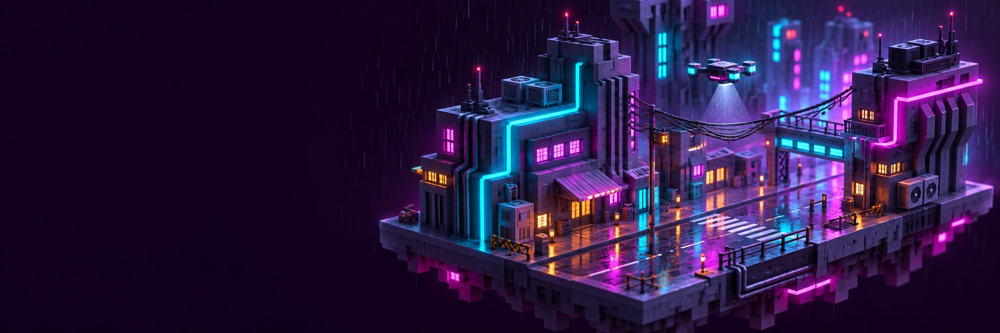

# Neon Rain City

  

A little cyberpunk city block you can orbit in your browser. Watch rain cross the neon-lit street, follow the drones, or turn on the soundtrack and let the camera drift.

[Open the live scene](https://agouti-ar.github.io/neon-rain-city/)

## Explore the scene

Drag to orbit and scroll or pinch to zoom. Turn on **Audio** to hear *Tokyo Midnight Rain* alongside procedural rain and synth ambience. Audio pauses while the tab is hidden.

The scene uses Three.js and procedural geometry for the architecture, overhead cables and rain effects. Fog and moving lights give the street depth. The camera and sound mix shift as you explore.

## Run locally

Serve the repository with a static HTTP server. There is no build step.

```sh
python -m http.server 5173
```

Open [localhost:5173](http://localhost:5173/) in your browser. The scene imports Three.js modules from a CDN.

The cover is an AI-generated illustration inspired by the scene.
